# Quero Entregas 2.0 — Tablet de 8 polegadas

Fluxo completo no tablet de 8 polegadas.

**31 etapas · versão v9 · 800 × 1280 · capturas em alta resolução.**

[Escolher outro formato](../README.md) · [Baixar tudo em ZIP](../fluxo-v9-tablet-celular.zip)

Telas reais do protótipo v9, com dados fictícios. Câmera e fotos de demonstração são sintéticas. Referência em retrato: tablet 800 × 1280 e celular 390 × 844 pixels de área útil; capturas em 2× para ampliar. O tamanho de 8 polegadas não determina sozinho a área útil do navegador.

**Como ver:** toque na imagem ou em “Abrir tela em alta resolução” para ampliar. A primeira imagem mostra a área visível; o link de tela inteira inclui a rolagem quando houver.

O percurso ilustrado é o que está implementado: check-in → impressão → estoque/montagem → checkout → relatórios. A leitura de chegada com 52 mm, o pareamento 52+80 pelo facilitador e a foto compartilhada de vários pedidos no checkout continuam previstos para desenvolvimento. A comparação facial é configurável; estas capturas não mostram uma aprovação biométrica real.

## Check-in

### 01 · Ler o voucher do cliente

O voucher do site identifica o cadastro. O atendente pode usar a câmera, o leitor USB ou o código.

[Abrir tela em alta resolução](01-identificar-cliente.png)

[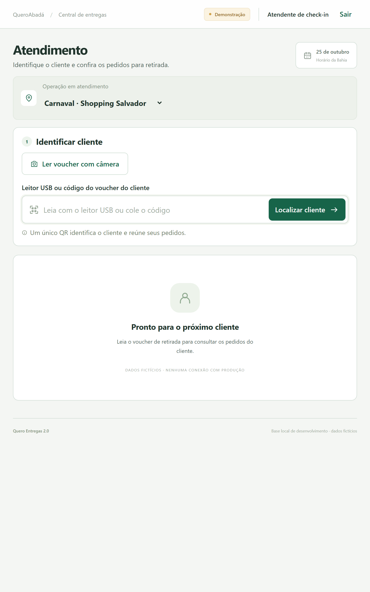](01-identificar-cliente.png)

### 02 · Câmera pronta para ler o voucher

O leitor abre sobre a própria tela; foco e ajustes dependem dos recursos da câmera. A imagem deste registro é sintética.

[Abrir tela em alta resolução](02-camera-voucher.png)

[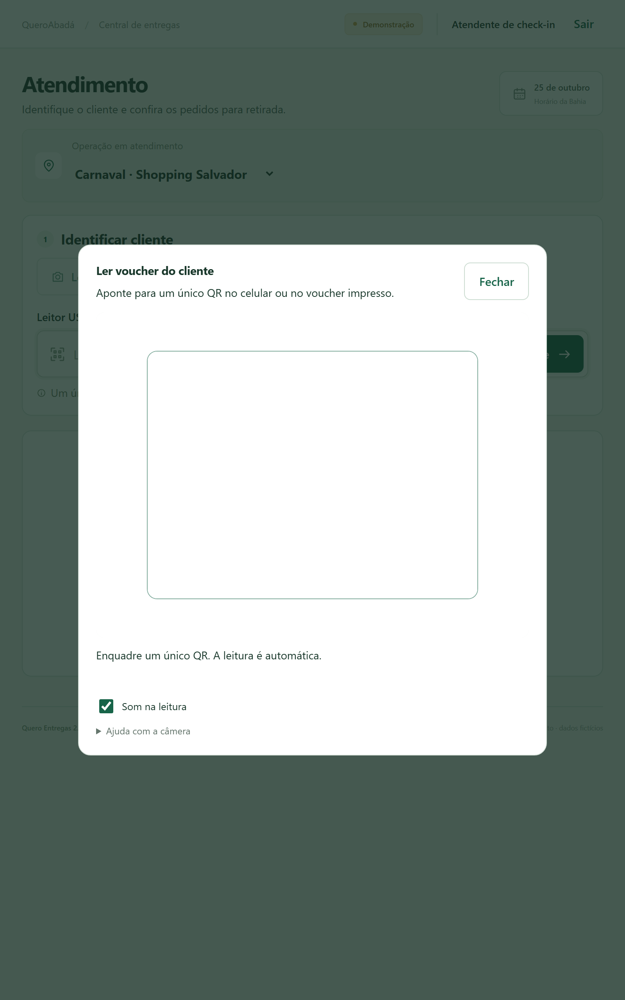](02-camera-voucher.png)

### 03 · Pedidos disponíveis e impedimentos

O mesmo cliente possui dois pedidos liberados. Os demais aparecem com os motivos que impedem a retirada.

[Abrir tela em alta resolução](03-pedidos-do-cliente.png) · [Ver tela inteira com rolagem](03-pedidos-do-cliente-inteira.png)

[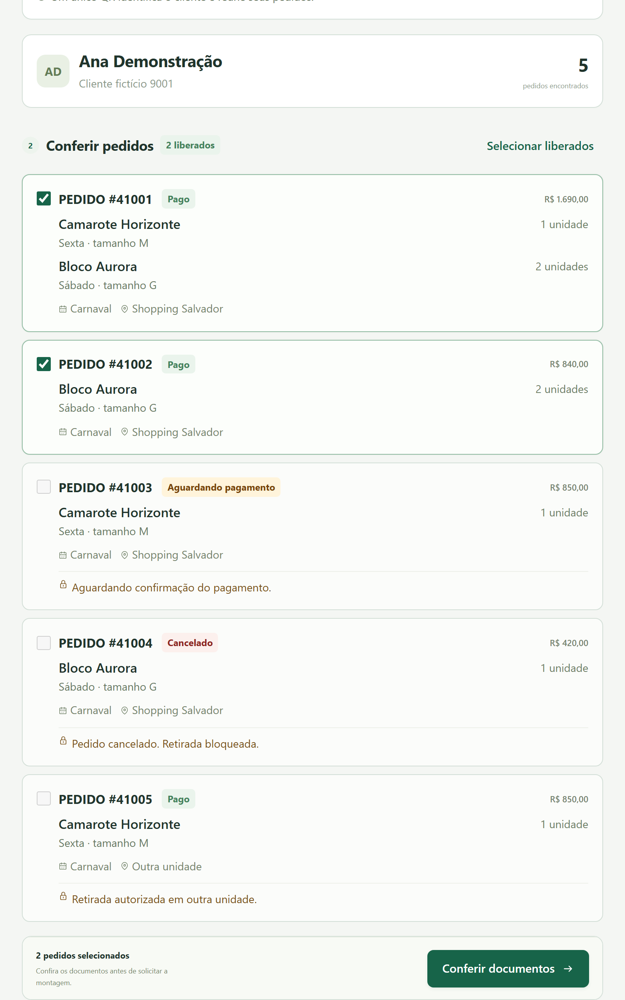](03-pedidos-do-cliente.png)

### 04 · Selecionar e conferir documentos

A ação segue para a conferência dos pedidos selecionados. Pedido já entregue ou bloqueado não é liberado.

[Abrir tela em alta resolução](04-pedidos-selecionados.png) · [Ver tela inteira com rolagem](04-pedidos-selecionados-inteira.png)

[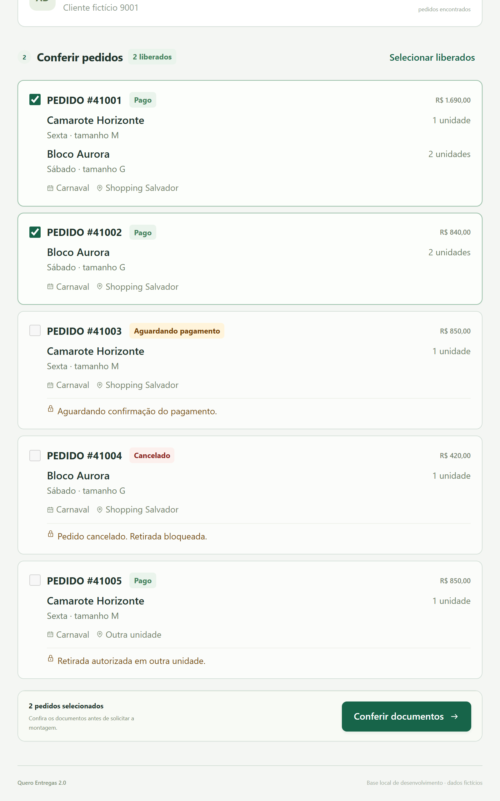](04-pedidos-selecionados.png)

### 05 · Identidade uma vez e cartões distintos

A conferência reúne a identidade comum e os dois cartões de pagamento exigidos pelos pedidos, com o vínculo de cada documento.

[Abrir tela em alta resolução](05-documentos-consolidados.png)

**Continuação da mesma tela após rolar:**

[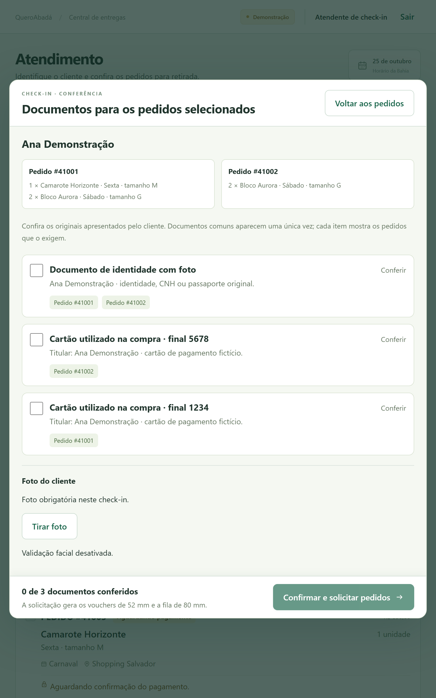](05-documentos-consolidados-continuacao.png)

### 06 · Fotografar no check-in

A captura fica dentro do atendimento. Esta demonstração usa uma imagem artificial; foto e facial têm exigências configuráveis.

[Abrir tela em alta resolução](06-camera-foto-checkin.png)

[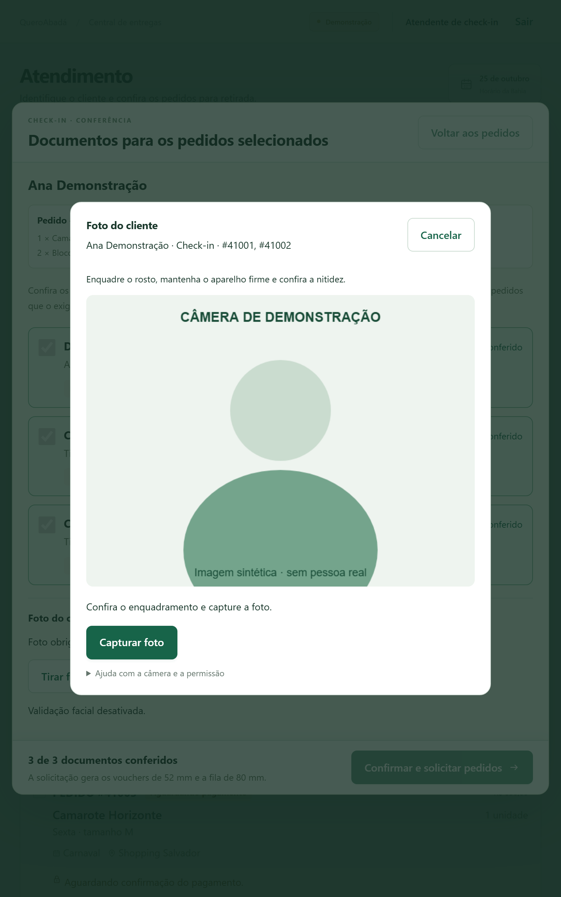](06-camera-foto-checkin.png)

### 07 · Conferir a foto antes de salvar

O atendente pode refazer ou salvar. A imagem é reduzida no aparelho conforme a configuração da retirada.

[Abrir tela em alta resolução](07-confirmar-foto-checkin.png)

[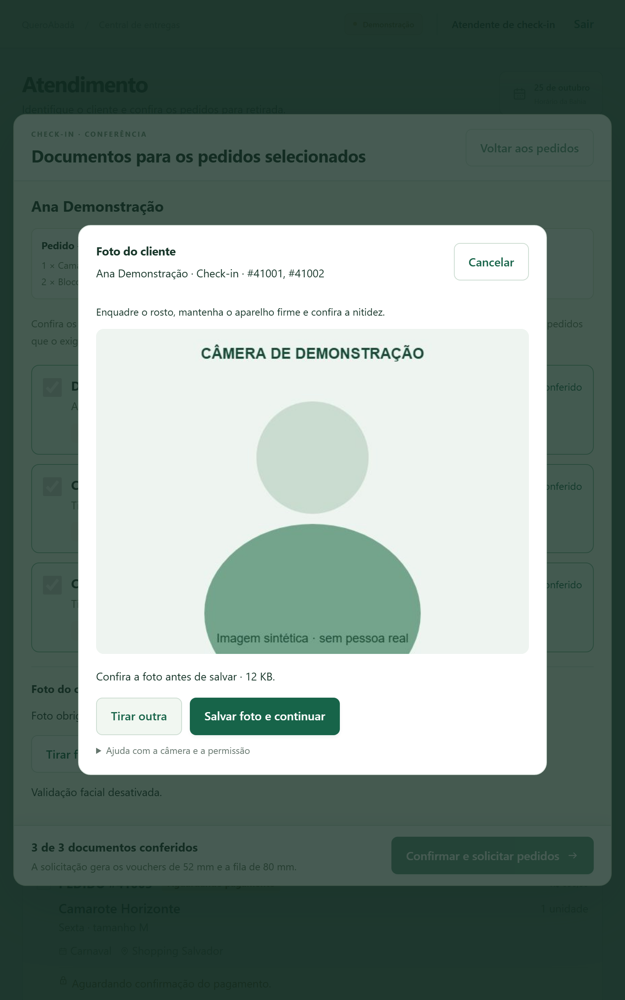](07-confirmar-foto-checkin.png)

### 08 · Documentos conferidos e foto salva

A confirmação solicita os dois pedidos. Check-in e solicitação ainda não representam entrega ao cliente.

[Abrir tela em alta resolução](08-solicitar-pedidos.png)

**Continuação da mesma tela após rolar:**

[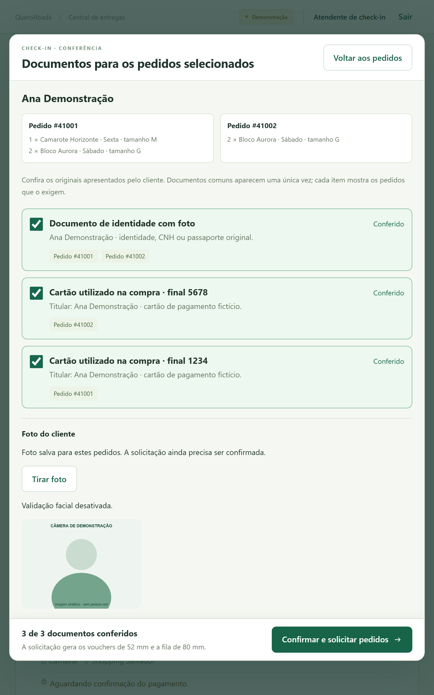](08-solicitar-pedidos-continuacao.png)

### 09 · Um voucher de 52 mm por pedido

Dois pedidos solicitados geram dois vouchers. É a prévia de impressão; nenhuma impressora física é acionada nesta captura.

[Abrir tela em alta resolução](09-vouchers-52mm.png)

[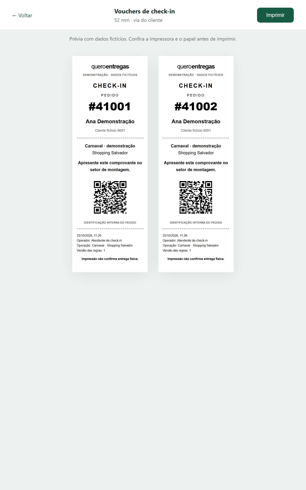](09-vouchers-52mm.png)

## Impressão

### 10 · Assumir o próximo pedido

O posto de impressão aparece antes da fila, com a ação principal em destaque.

[Abrir tela em alta resolução](10-fila-impressao.png)

[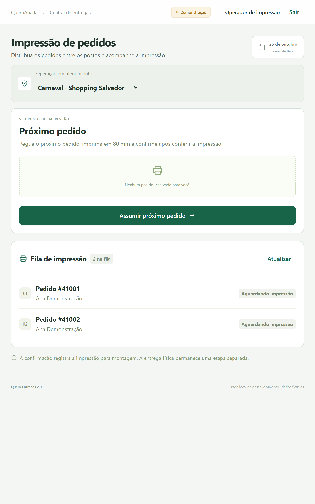](10-fila-impressao.png)

### 11 · Pedido reservado para este operador

A reserva evita dois operadores assumirem simultaneamente o mesmo trabalho de impressão.

[Abrir tela em alta resolução](11-pedido-reservado.png)

[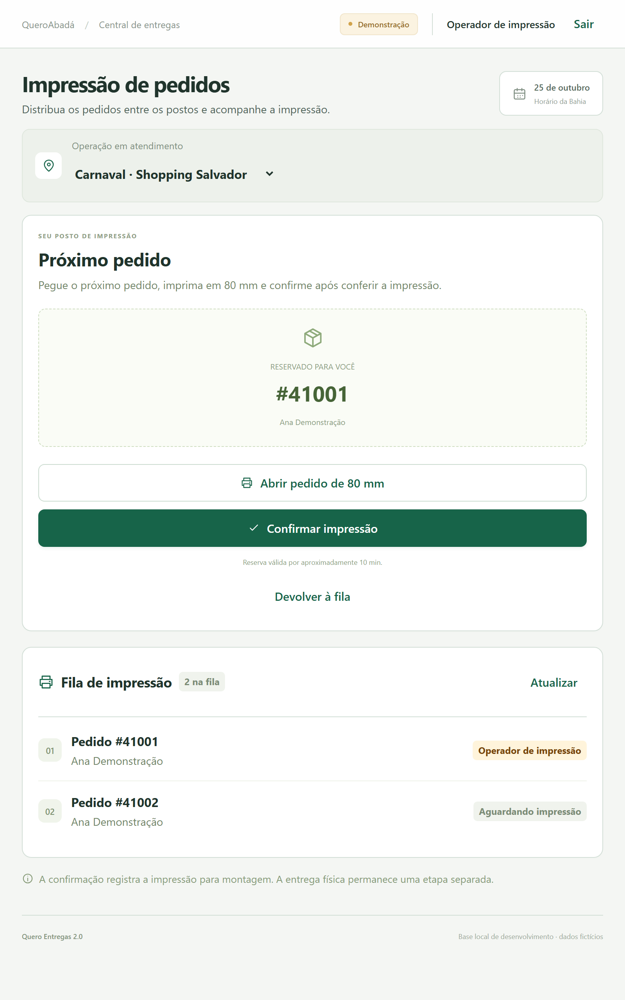](11-pedido-reservado.png)

### 12 · Impresso de montagem com QR de entrega

O documento de 80 mm acompanha o pacote. Seu QR dedicado identifica o pedido para a confirmação final.

[Abrir tela em alta resolução](12-pedido-80mm.png)

[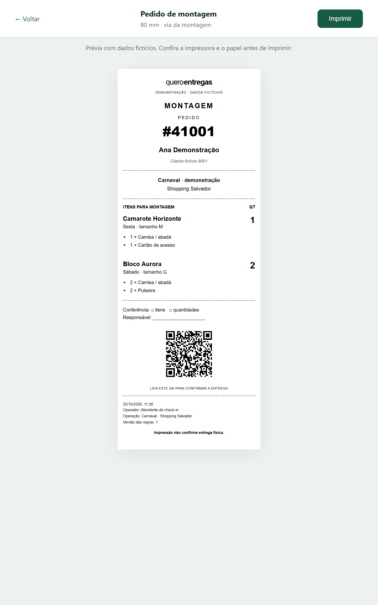](12-pedido-80mm.png)

### 13 · Impressão confirmada para montagem

Confirmar a impressão mantém a entrega física pendente.

[Abrir tela em alta resolução](13-impressao-confirmada.png)

[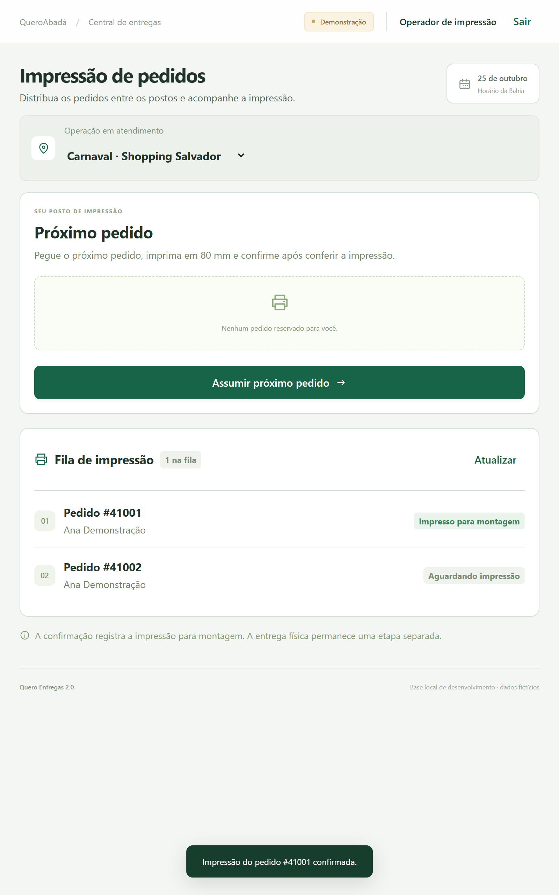](13-impressao-confirmada.png)

## Estoque

### 14 · Registrar entrada no estoque central

Recebimento de camisas, cartões e pulseiras com quantidade, fornecedor, motivo e referência.

[Abrir tela em alta resolução](14-entrada-estoque.png) · [Ver tela inteira com rolagem](14-entrada-estoque-inteira.png)

[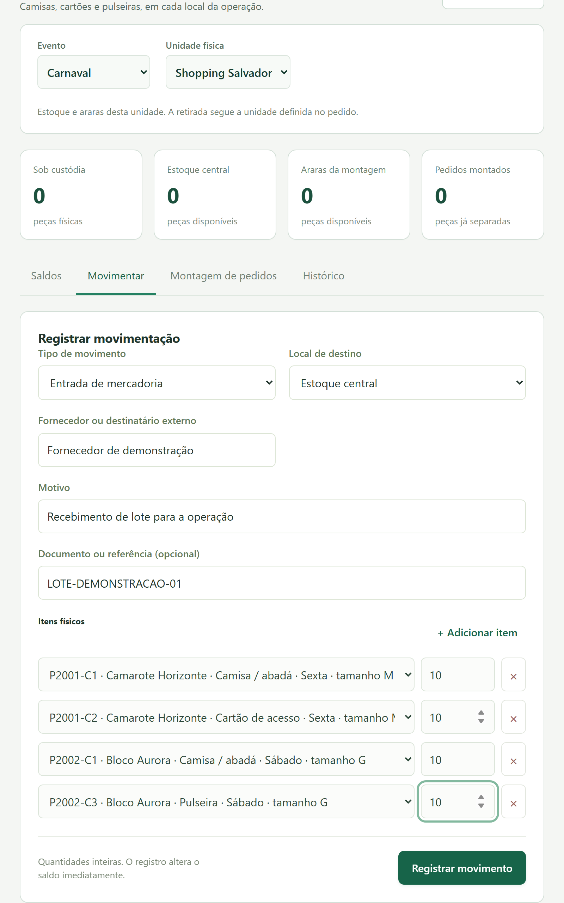](14-entrada-estoque.png)

### 15 · Peças recebidas no estoque central

As 40 peças do lote estão no central. Impressão e importação de pedido não criam saldo físico.

[Abrir tela em alta resolução](15-estoque-central.png)

[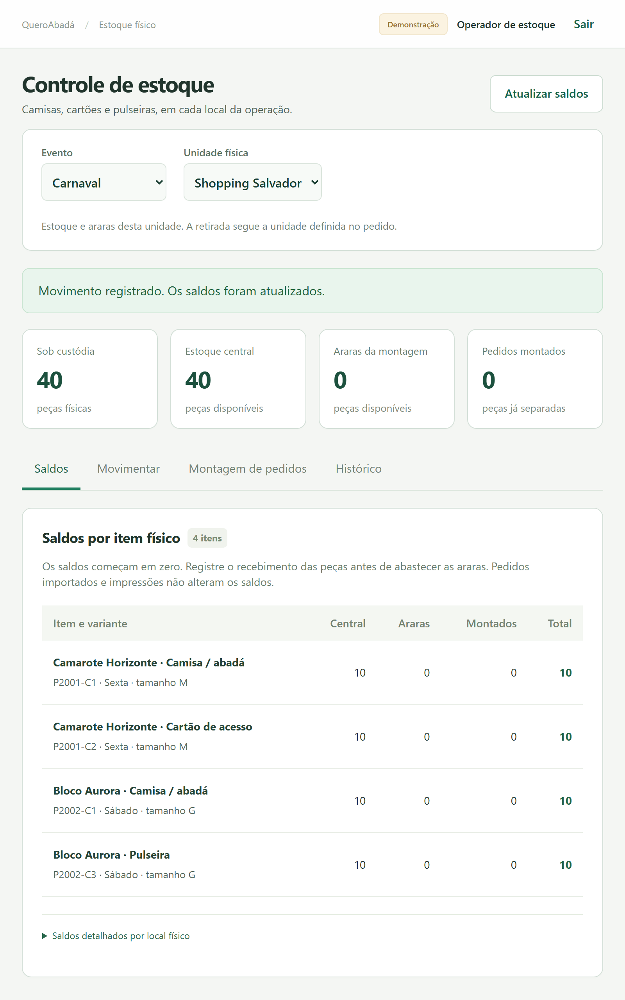](15-estoque-central.png)

### 16 · Abastecer as araras

Transferência do estoque central para as araras de montagem, com registro de origem e destino.

[Abrir tela em alta resolução](16-abastecer-araras.png) · [Ver tela inteira com rolagem](16-abastecer-araras-inteira.png)

[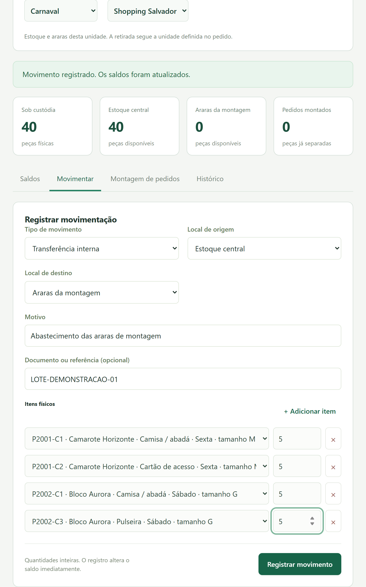](16-abastecer-araras.png)

### 17 · Central e araras com saldos separados

O total continua em 40 peças: 20 no central e 20 nas araras.

[Abrir tela em alta resolução](17-araras-abastecidas.png)

[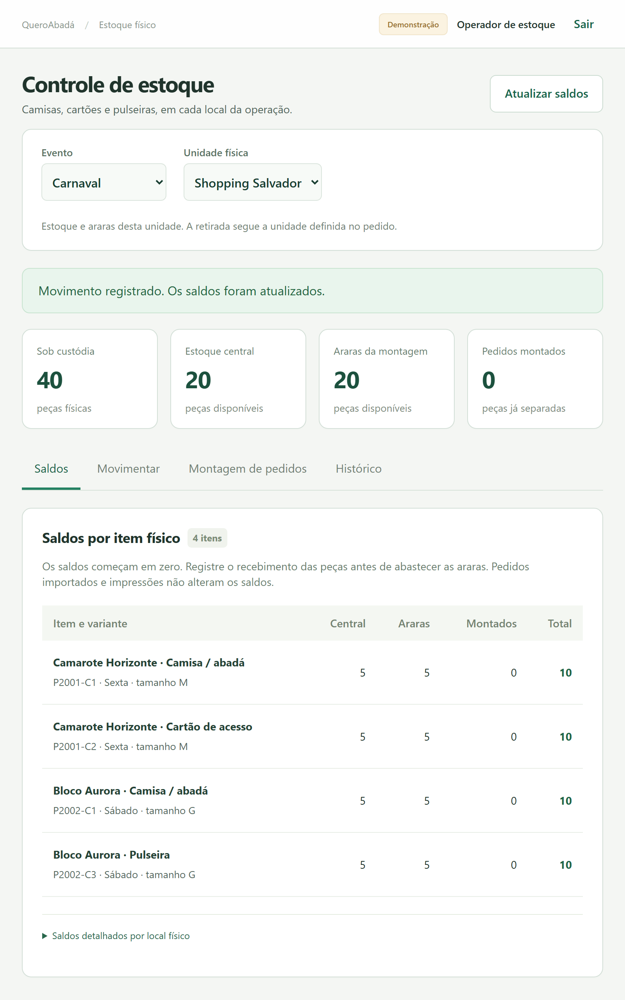](17-araras-abastecidas.png)

## Montagem

### 18 · Conferir os componentes e montar

A equipe vê pedido, cliente e componentes. A confirmação registra a separação física para o local de montados.

[Abrir tela em alta resolução](18-conferir-montagem.png)

[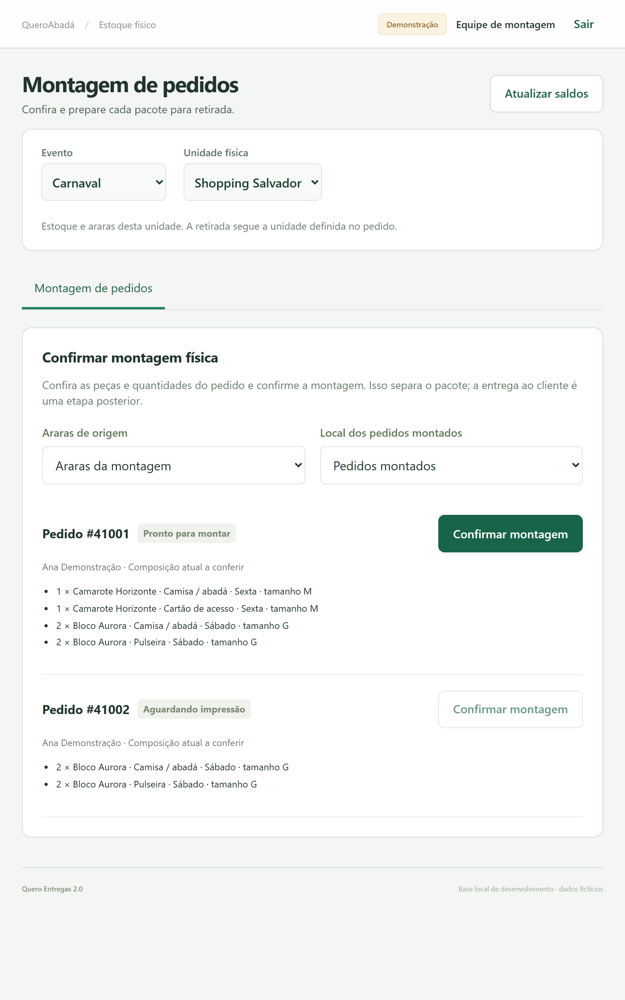](18-conferir-montagem.png)

### 19 · Pacote montado, ainda não entregue

A montagem move as peças das araras para os pedidos montados. O checkout permanece pendente.

[Abrir tela em alta resolução](19-pedido-montado.png)

[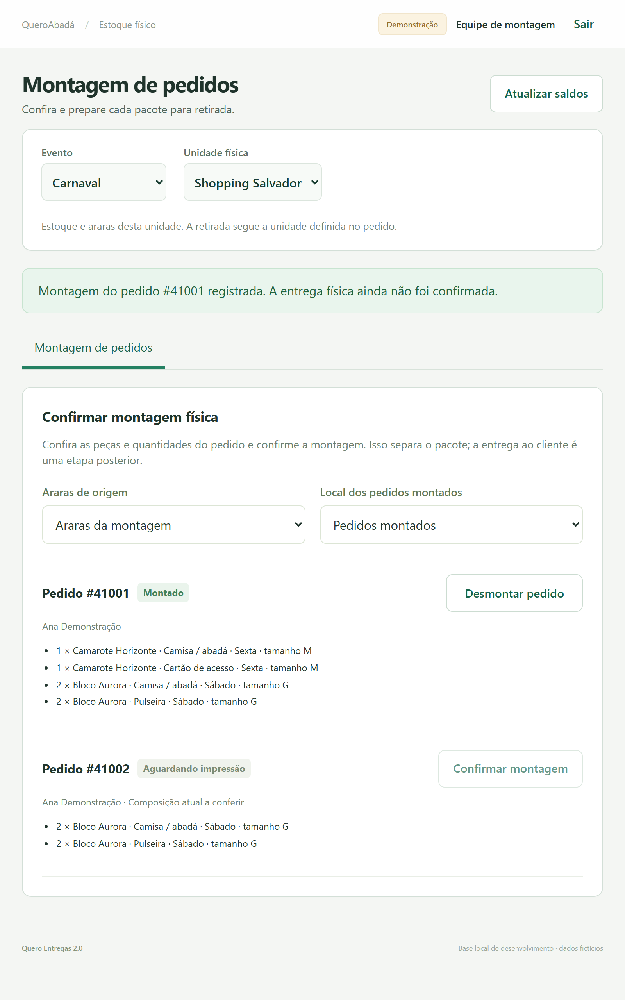](19-pedido-montado.png)

## Estoque

### 20 · Acompanhar os pacotes montados

O estoque distingue peças no central, nas araras e já separadas em pedidos.

[Abrir tela em alta resolução](20-saldo-montados.png)

[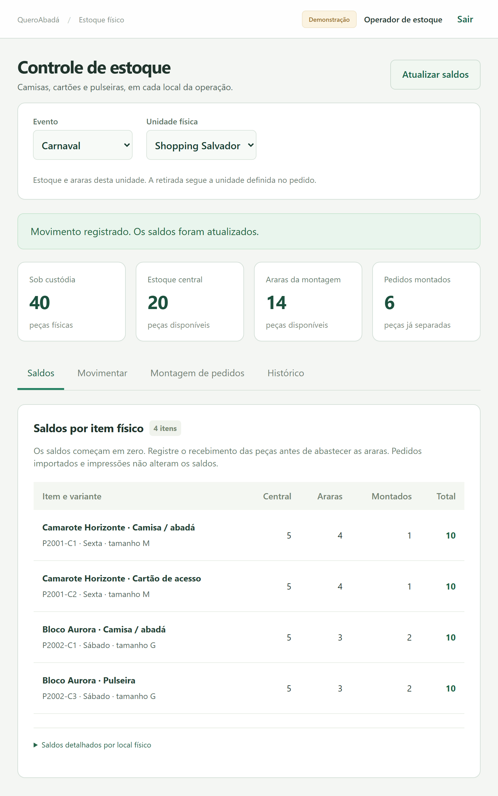](20-saldo-montados.png)

## Checkout

### 21 · Conferir com o cliente e ler o QR de 80 mm

O checkout oferece câmera e leitor USB. Esta versão confirma a entrega pelo QR do pedido; chegada de 52 mm e pareamento do facilitador ainda não estão implementados.

[Abrir tela em alta resolução](21-checkout-inicial.png)

[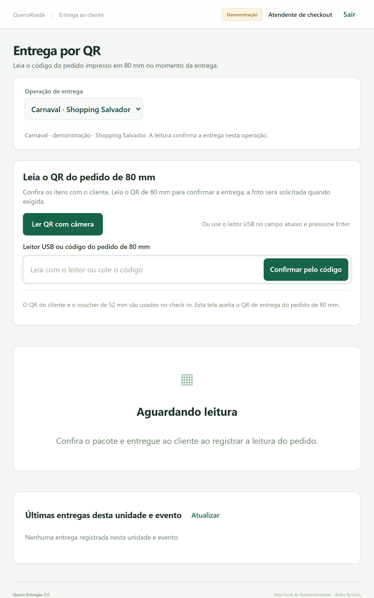](21-checkout-inicial.png)

### 22 · Leitura do QR do pacote

A leitura é feita na câmera do próprio aparelho. O QR do cliente e o voucher de 52 mm não confirmam a entrega.

[Abrir tela em alta resolução](22-camera-qr-80mm.png)

[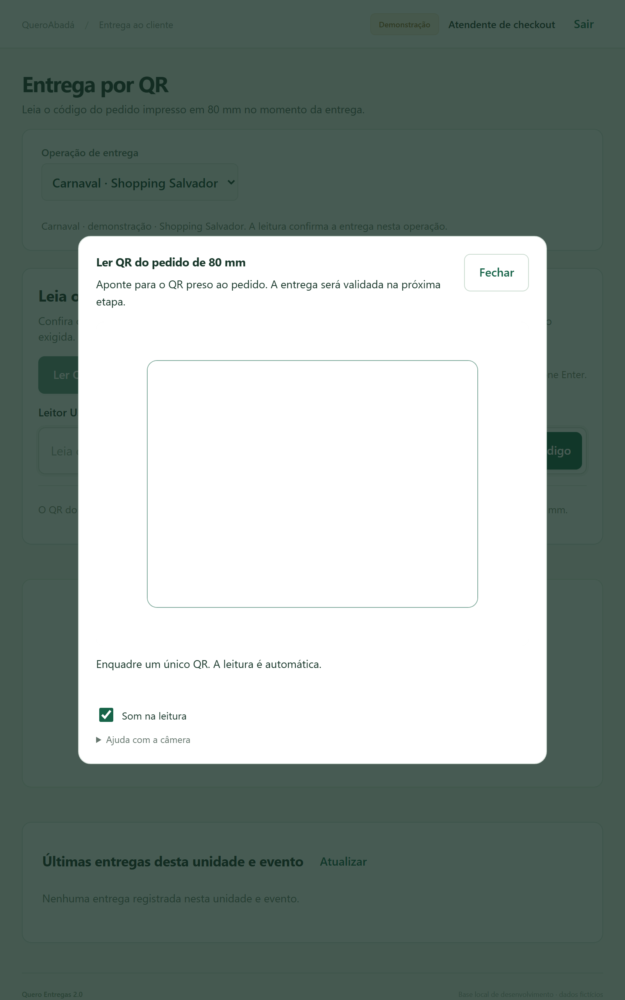](22-camera-qr-80mm.png)

### 23 · Foto no momento da entrega

Com a exigência de foto ativada, a entrega aguarda a captura e a confirmação. Nesta versão a foto de checkout é por pedido.

[Abrir tela em alta resolução](23-foto-checkout.png)

[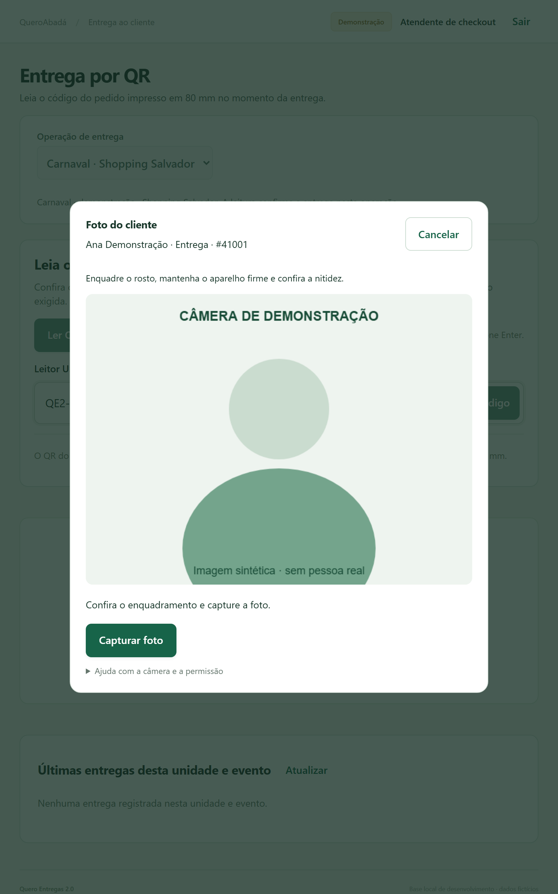](23-foto-checkout.png)

### 24 · Conferir a foto da entrega

É possível refazer antes de salvar. Cancelar a foto não conclui a entrega.

[Abrir tela em alta resolução](24-confirmar-foto-checkout.png)

[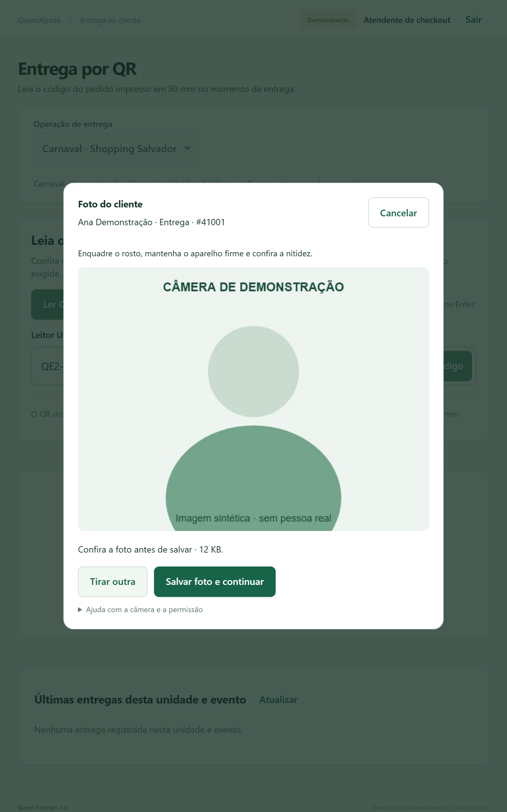](24-confirmar-foto-checkout.png)

### 25 · Entrega confirmada e próximo pedido

Cliente, pedido, produtos, operador e horário aparecem no resultado, com atalhos para a próxima leitura.

[Abrir tela em alta resolução](25-entrega-confirmada.png) · [Ver tela inteira com rolagem](25-entrega-confirmada-inteira.png)

[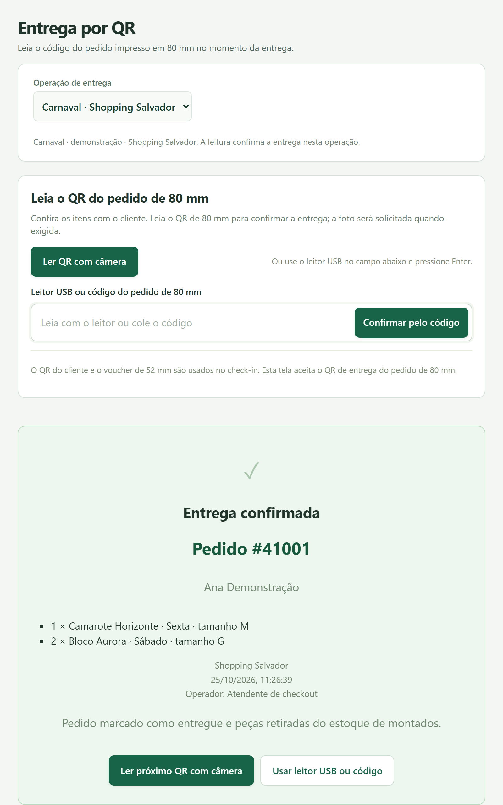](25-entrega-confirmada.png)

### 26 · Uma releitura preserva a entrega original

O pedido aparece como já entregue. A nova leitura não gera outra entrega, foto ou baixa de estoque.

[Abrir tela em alta resolução](26-protecao-duplicidade.png) · [Ver tela inteira com rolagem](26-protecao-duplicidade-inteira.png)

[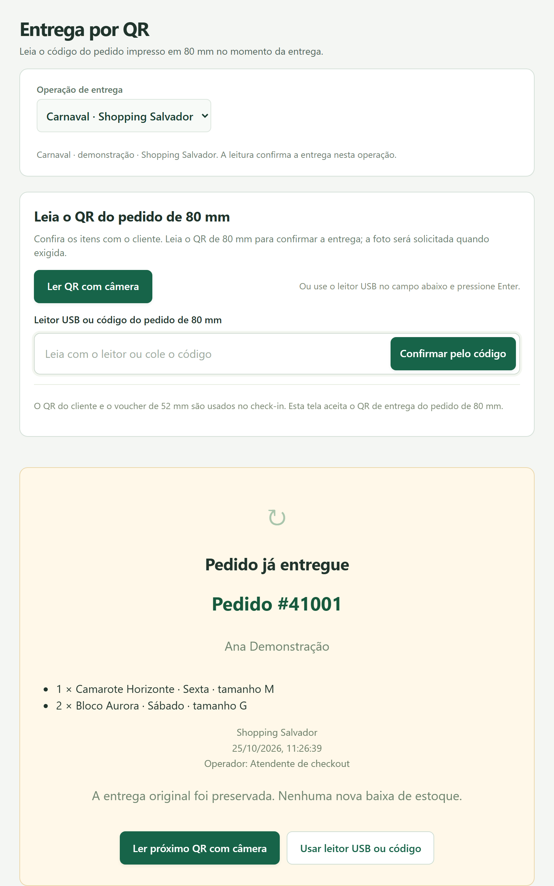](26-protecao-duplicidade.png)

## Estoque

### 27 · Histórico da entrega e dos movimentos

A baixa do pacote fica vinculada ao pedido, ao operador e ao horário. Os movimentos anteriores permanecem registrados.

[Abrir tela em alta resolução](27-historico-estoque.png) · [Ver tela inteira com rolagem](27-historico-estoque-inteira.png)

[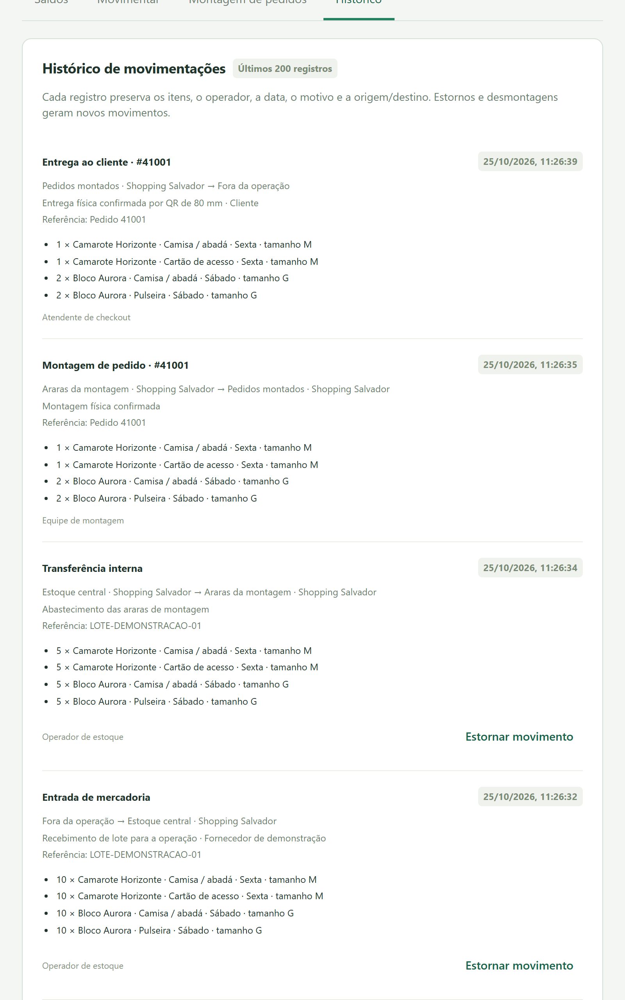](27-historico-estoque.png)

## Relatórios

### 28 · Entregas com produtos, operador e horário

Relatório da entrega concluída e acesso às pendências. A tela roda no módulo de relatórios.

[Abrir tela em alta resolução](28-relatorio-entregas.png) · [Ver tela inteira com rolagem](28-relatorio-entregas-inteira.png)

[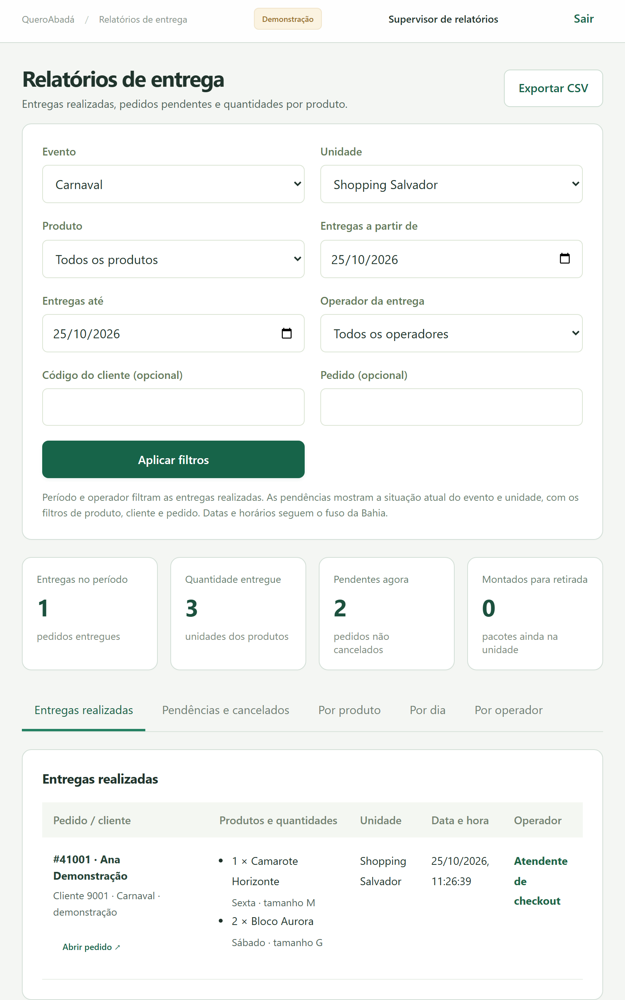](28-relatorio-entregas.png)

### 29 · Retirados e faltantes por produto

A relação separa o que já foi retirado, o que falta retirar e os cancelados.

[Abrir tela em alta resolução](29-relatorio-produto.png) · [Ver tela inteira com rolagem](29-relatorio-produto-inteira.png)

[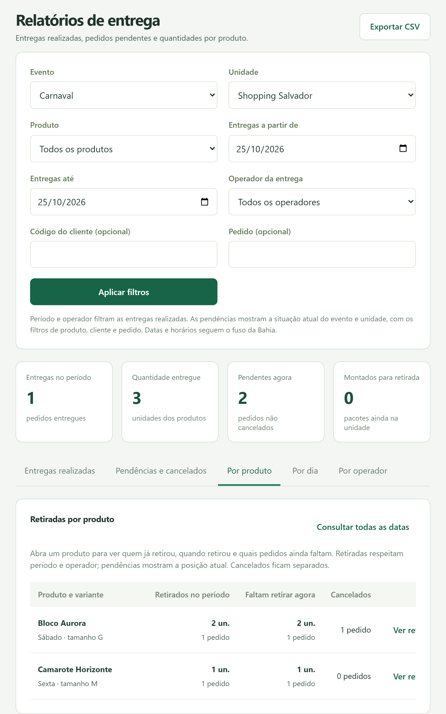](29-relatorio-produto.png)

### 30 · Quem retirou e quem ainda falta

Detalhamento por cliente e pedido, com data, horário, operador e abertura rápida.

[Abrir tela em alta resolução](30-detalhe-produto.png) · [Ver tela inteira com rolagem](30-detalhe-produto-inteira.png)

[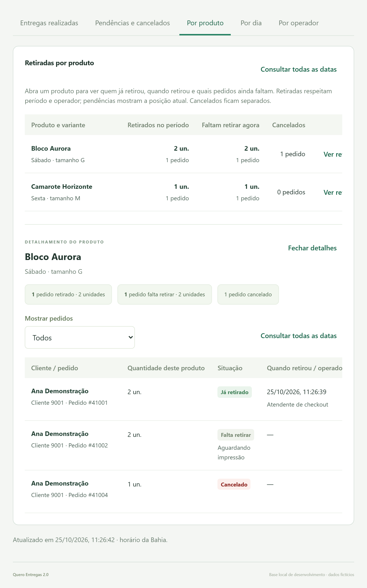](30-detalhe-produto.png)

### 31 · Abrir o pedido completo

A consulta rápida mantém o nome do cliente e todos os produtos do pedido, mesmo partindo de um produto do relatório.

[Abrir tela em alta resolução](31-pedido-completo.png)

[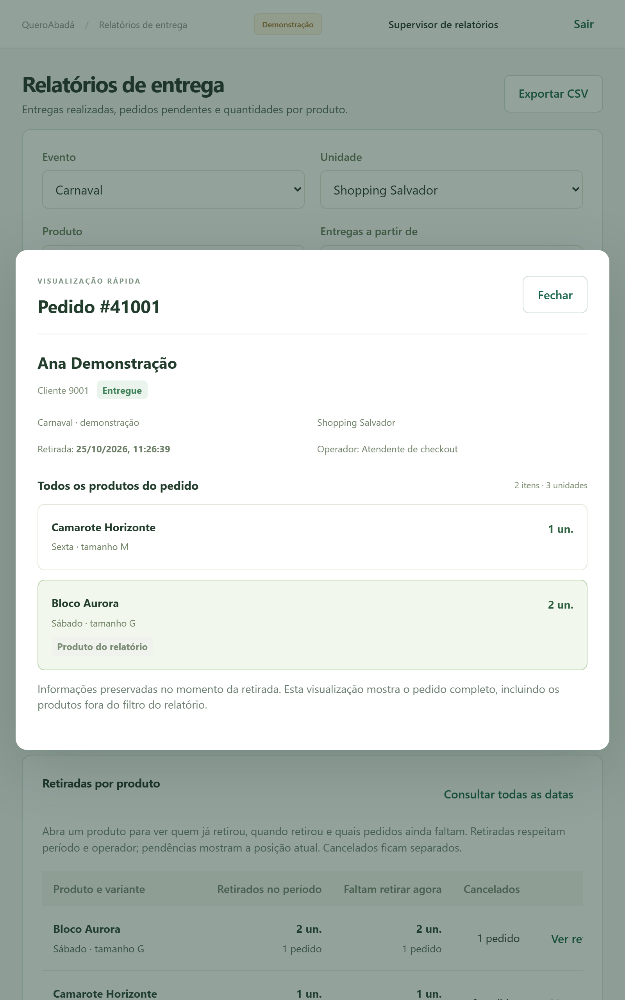](31-pedido-completo.png)

---

Capturas geradas em 25/10/2026, 11:26:43, horário da Bahia. Base isolada, sem alterar o legado ou os dados do protótipo aberto. Impressão, câmeras e uso físico em tablet/celular precisam de homologação.
